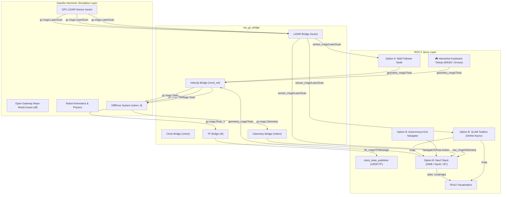

# 🤖 Autonomous & Teleoperated Maze Robot Simulation

A complete, production-grade autonomous mobile robot simulation built for **ROS 2 Jazzy** and **Gazebo Harmonic (Gazebo Sim 8)**. This repository implements an end-to-end robotics software stack covering physics simulation, robot modeling (URDF/Xacro), hardware bridging, interactive keyboard teleoperation, reactive algorithmic solving, and full autonomous SLAM & Nav2 navigation.

[](https://docs.ros.org/en/jazzy/)
[](https://gazebosim.org/docs/harmonic/)
[](LICENSE)

---

## 🗺️ System Architecture



---

## 🛠️ Technology Stack Breakdown

| Layer | Component | Description |
| :--- | :--- | :--- |
| **Physics & Environment** | **Gazebo Harmonic (gz-sim 8)** | High-fidelity physics simulation, friction, collision geometry, lighting, and modular maze environment with **open entrance and exit gateways** (`maze.sdf`). |
| **Robot Hardware Model** | **URDF / Xacro** | Kinematic tree (`base_footprint` $\rightarrow$ `base_link` $\rightarrow$ wheels, casters, LiDAR tower), accurate inertia tensors, and materials. |
| **Sensors** | **Planar 360° LiDAR & Odometry** | 15 Hz 2D GPU laser scanner with Gaussian noise model, wheel encoders, and dynamic odometry frame broadcasting. |
| **Middleware Bridge** | **ros_gz_bridge** | High-throughput bi-directional translation for `/clock`, `/scan`, `/cmd_vel`, `/odom`, `/tf`, and `/joint_states`. |
| **Manual Control** | **Keyboard Teleoperation** | Interactive non-blocking terminal steering with WASD and Arrow keys, speed adjustments, and emergency braking. |
| **Solving Logic (Option A)** | **Algorithmic Wall Follower** | Reactive Python ROS 2 node with multi-sector LiDAR range filtering, emergency un-stuck recovery, and proportional wall tracking. |
| **Solving Logic (Option B)** | **SLAM Toolbox & Nav2** | Ceres-based 2D SLAM for online mapping + Nav2 stack (DWB local planner, Navfn global planner, costmaps, and behavior recovery servers). |

---

## 📂 Repository Structure

```
maze_simulation/
├── config/
│   ├── nav2_params.yaml          # Nav2 planner, controller, and costmap tuning
│   ├── ros_gz_bridge.yaml        # ROS 2 <-> Gazebo Harmonic bridge configuration
│   └── slam_toolbox_params.yaml  # SLAM Toolbox online async mapping parameters
├── launch/
│   ├── maze_world.launch.py      # Launch Gazebo Harmonic maze environment
│   ├── maze_sim.launch.py        # Integrated sim, bridge, robot spawner & RViz
│   ├── teleop.launch.py          # Simulation launch ready for keyboard teleop
│   ├── wall_follower.launch.py   # Option A: Simulation + Algorithmic Wall Follower
│   ├── slam.launch.py            # Option B: Simulation + SLAM Toolbox mapping
│   └── navigation.launch.py      # Option B: Full autonomous Navigation (Nav2 + SLAM)
├── maze_simulation/
│   ├── __init__.py
│   ├── teleop_keyboard.py        # Interactive WASD & Arrow Key Teleoperation
│   ├── wall_follower.py          # Proportional right-hand wall-following controller
│   └── maze_navigator.py         # Nav2 Action Client to navigate directly to the exit
├── rviz/
│   ├── robot_view.rviz           # RViz setup for robot, TF, odometry, and scan rays
│   └── nav2_view.rviz            # RViz setup for mapping, costmaps, paths, and goals
├── urdf/
│   └── robot.urdf.xacro          # Robot model with differential drive & LiDAR plugins
├── worlds/
│   └── maze.sdf                  # Navigable labyrinth with open entrance and exit
├── package.xml                   # ROS 2 package dependencies
├── setup.py                      # Build and entry points configuration
└── setup.cfg
```

---

## 🚀 Quickstart & Installation

### 1. Prerequisites (Ubuntu 24.04 / WSL2)

```bash
# Update package lists
sudo apt update

# Install ROS-Gazebo bridge and simulation packages
sudo apt install -y \
  ros-jazzy-ros-gz \
  ros-jazzy-ros-gz-sim \
  ros-jazzy-ros-gz-bridge \
  ros-jazzy-robot-state-publisher \
  ros-jazzy-xacro \
  ros-jazzy-teleop-twist-keyboard \
  ros-jazzy-slam-toolbox \
  ros-jazzy-nav2-bringup
```

### 2. Workspace Setup & Build

```bash
# Create or enter your ROS 2 workspace
mkdir -p ~/maze_robot_ws/src
cd ~/maze_robot_ws/src

# Clone the repository
git clone https://github.com/Vishnu-2345/maze_simulation.git

# Build the package
cd ~/maze_robot_ws
source /opt/ros/jazzy/setup.bash
colcon build --symlink-install

# Source the workspace overlay
source install/setup.bash
```

---

## 🎮 Driving the Robot (Manual Keyboard Teleoperation)

To manually pilot the robot through the maze using your keyboard:

### Terminal 1: Launch the Simulation
```bash
source install/setup.bash
ros2 launch maze_simulation maze_sim.launch.py
```

### Terminal 2: Run the Keyboard Controller
```bash
source install/setup.bash
ros2 run maze_simulation teleop_keyboard
```

### ⌨️ Control Keybindings:
* **`W`** / **`↑`**: Drive Forward
* **`S`** / **`↓`**: Reverse / Backward
* **`A`** / **`←`**: Rotate Left in place
* **`D`** / **`→`**: Rotate Right in place
* **`Q`** / **`E`**: Curve Forward Left / Right
* **`Z`** / **`C`**: Curve Backward Left / Right
* **`SPACE`** or **`X`**: **Emergency Stop / Brake**
* **`+`** / **`-`**: Speed Up / Slow Down

---

## 🕹️ Autonomous Modes

### Mode 1: Algorithmic Wall Follower (Right-Wall Following)
```bash
ros2 launch maze_simulation wall_follower.launch.py
```

### Mode 2: Full Autonomous SLAM & Nav2 Navigation
```bash
# Terminal 1: Start SLAM + Navigation Stack + RViz
ros2 launch maze_simulation navigation.launch.py

# Terminal 2: Automatically dispatch the goal to the maze exit
source install/setup.bash
ros2 run maze_simulation maze_navigator
```
*You can also click the **2D Goal Pose** button in RViz2 to command the robot to drive to any point in the maze!*

---

## 🚪 Open-Gateway Maze Environment

* **South Entrance Gateway:** Open 2.0-meter gate flanked by green pillars at $x = -4.5, y = -6.0$.
* **North Exit Gateway:** Open 2.0-meter gate flanked by gold pillars at $x = 4.5, y = 6.0$.
* **Wide Corridors:** Corridor widths range between **2.2m and 3.5m**, providing generous clearance so you can drive smoothly without getting stuck on walls.

---

## 📜 License
This project is open-source under the **Apache-2.0 License**.
