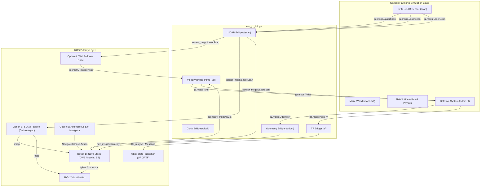

# 🤖 Autonomous Maze-Solving Robot Simulation

A complete, production-grade autonomous mobile robot simulation built for **ROS 2 Jazzy** and **Gazebo Harmonic (Gazebo Sim 8)**. This repository implements an end-to-end robotics software stack covering physics simulation, robot modeling (URDF/Xacro), hardware bridging, reactive algorithmic solving, and full autonomous SLAM & Nav2 navigation.

[](https://docs.ros.org/en/jazzy/)
[](https://gazebosim.org/docs/harmonic/)
[](LICENSE)

---

## 🗺️ System Architecture



---

## 🛠️ Technology Stack Breakdown

| Layer | Component | Description |
| :--- | :--- | :--- |
| **Physics & Environment** | **Gazebo Harmonic (gz-sim 8)** | High-fidelity physics simulation, friction, collision geometry, lighting, and modular maze environment (`maze.sdf`). |
| **Robot Hardware Model** | **URDF / Xacro** | Kinematic tree (`base_footprint` $\rightarrow$ `base_link` $\rightarrow$ wheels, casters, LiDAR tower), accurate inertia tensors, and materials. |
| **Sensors** | **Planar 360° LiDAR & Odometry** | 15 Hz 2D GPU laser scanner with Gaussian noise model, wheel encoders, and dynamic odometry frame broadcasting. |
| **Middleware Bridge** | **ros_gz_bridge** | High-throughput bi-directional translation for `/clock`, `/scan`, `/cmd_vel`, `/odom`, `/tf`, and `/joint_states`. |
| **Solving Logic (Option A)** | **Algorithmic Wall Follower** | Reactive Python ROS 2 node with multi-sector LiDAR range filtering, emergency un-stuck recovery, and proportional wall tracking. |
| **Solving Logic (Option B)** | **SLAM Toolbox & Nav2** | Ceres-based 2D SLAM for online mapping + Nav2 stack (DWB local planner, Navfn global planner, costmaps, and behavior recovery servers). |

---

## 📂 Repository Structure

```
maze_simulation/
├── config/
│   ├── nav2_params.yaml          # Nav2 planner, controller, and costmap tuning
│   ├── ros_gz_bridge.yaml        # ROS 2 <-> Gazebo Harmonic bridge configuration
│   └── slam_toolbox_params.yaml  # SLAM Toolbox online async mapping parameters
├── launch/
│   ├── maze_world.launch.py      # Phase 1: Launch Gazebo Harmonic maze environment
│   ├── maze_sim.launch.py        # Phase 2 & 3: Integrated sim, bridge, robot spawner & RViz
│   ├── wall_follower.launch.py   # Phase 4A: Simulation + Algorithmic Wall Follower
│   ├── slam.launch.py            # Phase 4B: Simulation + SLAM Toolbox mapping
│   └── navigation.launch.py      # Phase 4B: Full autonomous Navigation (Nav2 + SLAM)
├── maze_simulation/
│   ├── __init__.py
│   ├── wall_follower.py          # Proportional right-hand wall-following controller
│   └── maze_navigator.py         # Nav2 Action Client to navigate directly to the exit
├── rviz/
│   ├── robot_view.rviz           # RViz setup for robot, TF, odometry, and scan rays
│   └── nav2_view.rviz            # RViz setup for mapping, costmaps, paths, and goals
├── urdf/
│   └── robot.urdf.xacro          # Robot model with differential drive & LiDAR plugins
├── worlds/
│   └── maze.sdf                  # 12m x 12m labyrinth world with start & exit markers
├── package.xml                   # ROS 2 package dependencies
├── setup.py                      # Build and entry points configuration
└── setup.cfg
```

---

## 🚀 Quickstart & Installation

### 1. Prerequisites (Ubuntu 24.04 / WSL2)

Ensure you have **ROS 2 Jazzy** and **Gazebo Harmonic** installed:

```bash
# Update package lists
sudo apt update

# Install ROS-Gazebo bridge and simulation packages
sudo apt install -y \
  ros-jazzy-ros-gz \
  ros-jazzy-ros-gz-sim \
  ros-jazzy-ros-gz-bridge \
  ros-jazzy-robot-state-publisher \
  ros-jazzy-xacro \
  ros-jazzy-teleop-twist-keyboard \
  ros-jazzy-slam-toolbox \
  ros-jazzy-nav2-bringup
```

### 2. Workspace Setup & Build

Clone this repository into your ROS 2 workspace `src/` directory (or use directly):

```bash
# Create or enter your ROS 2 workspace
mkdir -p ~/maze_robot_ws/src
cd ~/maze_robot_ws/src

# Clone the repository
git clone https://github.com/Vishnu-2345/maze_simulation.git

# Build the package
cd ~/maze_robot_ws
source /opt/ros/jazzy/setup.bash
colcon build --symlink-install

# Source the workspace overlay
source install/setup.bash
```

---

## 🕹️ Step-by-Step Execution by Phase

### Phase 1: Build & Inspect the Maze Environment
Launch Gazebo Harmonic with the custom modular maze world (`worlds/maze.sdf`):
```bash
ros2 launch maze_simulation maze_world.launch.py
```
*Features: Enclosed outer walls (12m x 12m), interior labyrinth corridors, start platform (green disc at `(-4.5, -4.5)`), and exit platform (gold disc at `(4.5, 4.5)`).*

---

### Phase 2 & 3: Spawn Robot Model & Verify ROS-Gazebo Bridge
Spawn the differential-drive robot with LiDAR rays visualized in Gazebo and RViz2:
```bash
ros2 launch maze_simulation maze_sim.launch.py
```
To verify the communication pipeline in a separate terminal:
```bash
source install/setup.bash
ros2 topic echo /scan --once       # Confirm LiDAR distance data
ros2 topic echo /odom --once       # Confirm wheel odometry
ros2 topic pub /cmd_vel geometry_msgs/msg/Twist "{linear: {x: 0.2}, angular: {z: 0.2}}" --once
```

---

### Phase 4 - Option A: Reactive Wall-Follower Solving (Classic)
Run the algorithmic right-hand wall-follower node:
```bash
ros2 launch maze_simulation wall_follower.launch.py
```
*How it works:*
1. **FIND_WALL**: Drives straight until encountering an initial wall.
2. **TURN_LEFT**: Detects front obstacles within 0.55m and pivots cleanly.
3. **FOLLOW_WALL**: Uses proportional control ($u = -K_p \cdot e$) to track the right wall at exactly 0.45m distance.
4. **ROUND_CORNER**: Smoothly wraps around outer corners without oscillating.
5. **EMERGENCY_REVERSE**: Safely detects dead-ends (< 0.28m) and backs up with turning.

---

### Phase 4 - Option B: Full Autonomous SLAM & Nav2 (Professional)

#### 1. Launch Autonomous Navigation & SLAM
```bash
ros2 launch maze_simulation navigation.launch.py
```
This single launch file starts:
- Gazebo Harmonic simulation with the maze
- ROS-Gazebo bridge and `robot_state_publisher`
- **SLAM Toolbox** for continuous dynamic mapping
- **Nav2 Stack** (Planner, Controller, Costmaps, Behavior trees)
- **RViz2** with costmaps, global paths, and the 2D Goal Pose tool

#### 2. Send the Robot to the Exit

You can either:
- **Interactive:** Click the **2D Goal Pose** button in RViz2 and place a goal at the gold exit marker (`x=4.5`, `y=4.5`).
- **Autonomous Script:** Run the dedicated navigator node:
```bash
ros2 run maze_simulation maze_navigator
```
*The navigator computes the shortest path around all labyrinth walls, updates progress in real time, and announces when the maze exit is reached!*

---

## 📡 Topic & Coordinate Frame Reference

| Topic | Type | Direction | Purpose |
| :--- | :--- | :--- | :--- |
| `/scan` | `sensor_msgs/msg/LaserScan` | GZ $\rightarrow$ ROS | 360° LiDAR range measurements |
| `/cmd_vel` | `geometry_msgs/msg/Twist` | ROS $\rightarrow$ GZ | Commanded linear & angular velocities |
| `/odom` | `nav_msgs/msg/Odometry` | GZ $\rightarrow$ ROS | Wheel odometry state |
| `/tf` | `tf2_msgs/msg/TFMessage` | Bi-directional | Transform tree (`map` $\rightarrow$ `odom` $\rightarrow$ `base_footprint`) |
| `/clock` | `rosgraph_msgs/msg/Clock` | GZ $\rightarrow$ ROS | Simulation time synchronization |
| `/map` | `nav_msgs/msg/OccupancyGrid` | SLAM $\rightarrow$ ROS | 2D Occupancy grid map of the maze |

---

## 📜 License
This project is open-source under the **Apache-2.0 License**.
